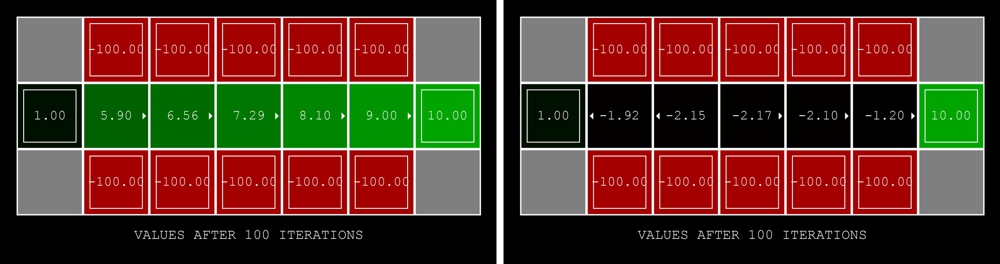
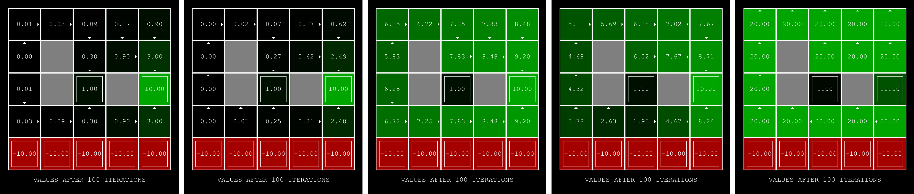
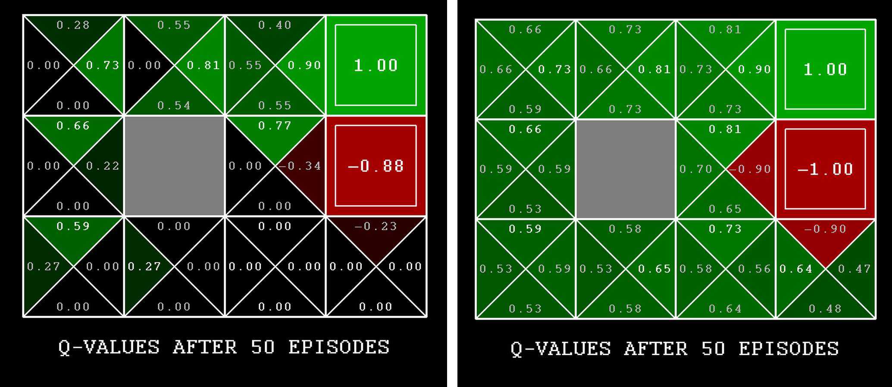
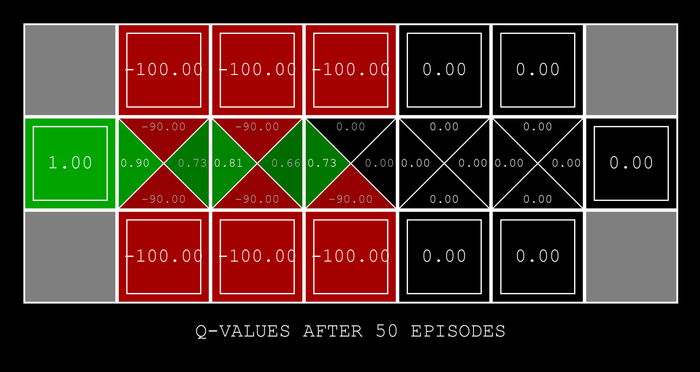
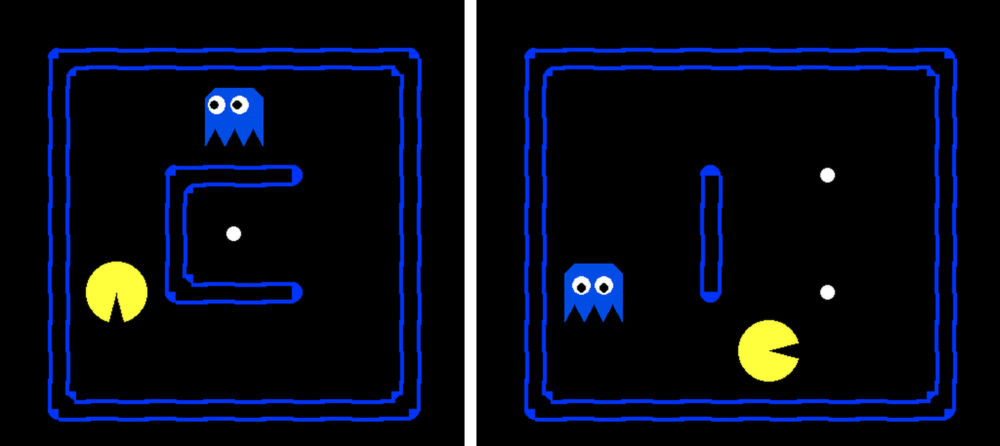
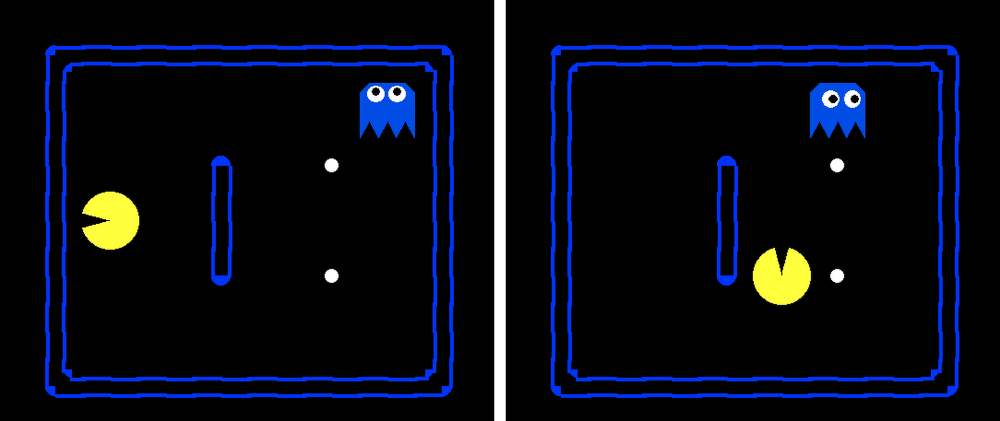

# Session 3: Reinforcement learning

**Group 07:** Elvis Los & Staf Dauwe

## Part I: Value iteration

### 1.1 Bridge crossing (Exercise 2)

| Changed parameter | Discount | Noise | Optimal action in start | Exit reached | Crosses the bridge? |
|---|---|---|---|---|---|
| Noise | 0.9 | **0.0** | east | +10 | **yes** |
| Discount | **0.1** | 0.2 | west | +1 | no |

Only lowering the **noise to 0** makes the agent cross.

- **Noise 0:** every action lands in the intended cell, so the chasm is never hit by accident. The +10 exit is worth $0.9^5 \cdot 10 = 5.90$ from the start, which beats the +1 exit next to it.
- **Discount only:** with noise 0.2, every step on the bridge has a 20 % chance to slip sideways into a −100 cell. Over five bridge cells that expected loss always outweighs the +10. We also tried discounts 0.99, 0.999 and 1.0: the start action stays west. A *lower* discount makes the distant +10 even less attractive.

### 1.2 Policies on DiscountGrid (Exercise 3)

| # | Desired policy | Discount | Noise | Living reward | Why it works |
|---|---|---|---|---|---|
| 1 | Close exit (+1), risking the cliff | 0.3 | 0.0 | 0.0 | Low discount: the far +10 is worth little. No noise: walking next to the cliff is safe. |
| 2 | Close exit (+1), avoiding the cliff | 0.3 | 0.2 | 0.0 | Same low discount, but noise makes the cliff path risky, so the agent takes the top route. |
| 3 | Distant exit (+10), risking the cliff | 0.9 | 0.0 | 0.2 | High discount: +10 dominates. No noise: the short path along the cliff is safe. |
| 4 | Distant exit (+10), avoiding the cliff | 0.9 | 0.3 | 0.2 | High discount, plus noise that makes the cliff path dangerous. |
| 5 | Avoid both exits and the cliff | 0.9 | 0.0 | 2.0 | Every step pays +2, more than any exit is worth, so the agent never ends the episode. |

Each row was checked by following the computed policy from the start without noise.

## Part II: Q-learning

### 2.1 BookGrid with ε = 0.1 and ε = 0.9 (Exercise 5)

| ε | Greedy path from the start | Exit | Q-values learned |
|---|---|---|---|
| 0.1 | Upper path: north along the left column, then east along the top row | +1 | Only along the path it happened to find; most other actions are still 0 |
| 0.9 | Upper or lower path: north and east are tied in the start (0.59) | +1 | Almost every action has a value, close to the value-iteration result |

- **Low ε:** the agent explores very little, so it keeps following the first route that reached +1. Which route that is depends on the run.
- **High ε:** the agent explores almost the whole grid. It therefore learns that both routes to +1 are equally long and equally good.

### 2.2 Bridge crossing revisited (Exercise 6)

**No configuration works.** There is no ε and learning rate for which the optimal policy is learned with more than 99 % probability after 50 episodes.

- We trained on the noiseless BridgeGrid for 50 episodes with every combination of ε ∈ {0, 0.1, 0.3, 0.5, 0.7, 0.9, 1} and learning rate ∈ {0.1, 0.5, 0.9, 1}, repeated 50 times each. Not one run learned a greedy policy towards +10.
- For the most favourable setting, **ε = 1 and learning rate = 1**, we repeated the full experiment 10 times and reset the agent each time: **0 out of 10** runs learned the optimal policy. Over those 500 episodes, the +10 exit was reached only once.

The reason lies in the structure of BridgeGrid:

- **Low ε:** once the agent reaches +1, that action gets a positive Q-value while all others stay 0. The agent keeps choosing it and never discovers +10.
- **High ε:** the agent walks almost randomly. On every bridge cell, two of the four actions lead into the chasm, so crossing all five cells by chance is very unlikely. The figure shows this: only the left part of the bridge has values, and the right part is still 0.
- **Even when +10 is reached once,** Q-learning moves that value back only one cell per visit. Five cells need many successful crossings, far more than 50 episodes allow.

### 2.3 PacmanQAgent on smallGrid and mediumGrid (Exercise 7)

| Layout | Training games | Test games won | Average test score |
|---|---|---|---|
| smallGrid | 2000 | 10 / 10 | 499.0 |
| mediumGrid | 2000 | 1 / 10 | −403.8 |

The agent reaches the highest test win rate on **smallGrid**. In Q-learning every exact board configuration is a separate state. smallGrid has few configurations, so 2000 games are enough to visit them often. mediumGrid has far more configurations, so most states are seen rarely or never, and the agent cannot generalise what it learned (for example that a ghost next to Pacman is dangerous) to positions it has not seen.

## Part III: Approximate Q-learning

### 3.1 IdentityExtractor vs SimpleExtractor on mediumGrid (Exercise 8)

| Extractor | Features produced | Test games won | Average test score |
|---|---|---|---|
| IdentityExtractor | One indicator feature per `(state, action)` pair, value 1.0 | 0 / 10 | −503.5 |
| SimpleExtractor | `bias`, `#-of-ghosts-1-step-away`, `eats-food`, `closest-food` | 10 / 10 | 527.2 |

- **IdentityExtractor** gives every `(state, action)` pair its own weight, so it behaves exactly like the tabular PacmanQAgent. After only 50 training games almost every state is still new.
- **SimpleExtractor** describes the situation with four general features. A weight learned in one position, such as "a ghost one step away is bad", applies to every position with the same features. That is why 50 training games are enough to win.

Both runs used 50 training games and 10 test games.
